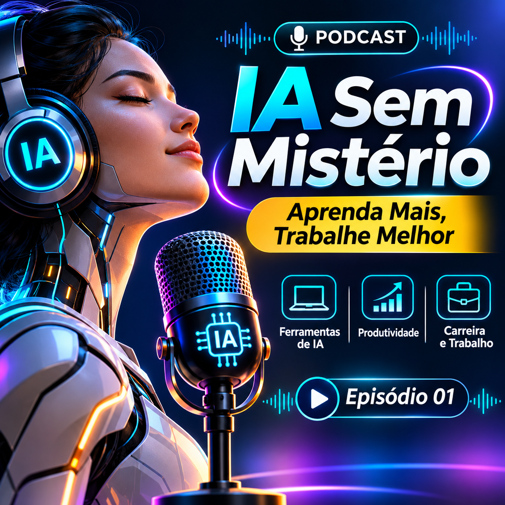

# 🎙️ IA Sem Mistério — Aprenda Mais, Trabalhe Melhor

## 📖 Sobre o projeto

Este projeto foi desenvolvido para o desafio **Criando um Podcast com IAs Generativas**, da plataforma DIO.

O objetivo foi produzir um episódio de podcast educativo utilizando ferramentas de inteligência artificial generativa, desde a elaboração do roteiro até a criação da narração e da capa.

## 🎧 Episódio 01

**Título:** Como a Inteligência Artificial pode ajudar você a aprender uma profissão

**Podcast:** IA Sem Mistério

**Duração:** Aproximadamente 1 minuto e 13 segundos

**Idioma:** Português brasileiro

**Narradora:** Isabel — ElevenLabs

### 🔊 Ouça o podcast

[🎧 Ouvir ou baixar o Episódio 01](IA-Sem-Misterio-Episódio-01.mp3)

## 🛠️ Tecnologias utilizadas

| Ferramenta | Utilização |
|---|---|
| ChatGPT — OpenAI | Criação do título e roteiro |
| ElevenLabs | Geração da narração com IA |
| CapCut | Edição e finalização do áudio |
| IA generativa de imagens | Criação da capa |
| GitHub | Documentação e publicação |

## 📝 Processo de criação

### 1. Definição do tema

Escolhi abordar como a inteligência artificial pode auxiliar pessoas no aprendizado de novas profissões e no desenvolvimento de habilidades.

### 2. Criação do roteiro

Utilizei o ChatGPT para desenvolver um roteiro educativo, com linguagem simples, exemplos práticos e uma mensagem sobre a importância do pensamento crítico.

### 3. Geração da narração

Utilizei o ElevenLabs com a voz Isabel, selecionada pela naturalidade da pronúncia em português brasileiro.

### 4. Edição do áudio

Importei a narração no CapCut e realizei os seguintes ajustes:

- Volume original: 0 dB
- Fade-in: 0,5 segundo
- Fade-out: 1 segundo
- Velocidade: 1,0x

O áudio foi exportado e preparado em MP3.

### 5. Criação da capa

Utilizei inteligência artificial generativa para criar uma identidade visual com elementos tecnológicos, microfone e referências à inteligência artificial.

## 📂 Arquivos do projeto

- `capa-podcast.png` — Capa do podcast.
- `IA-Sem-Misterio-Episódio-01.mp3` — Áudio final.
- `prompts.md` — Prompts utilizados na criação.
- `.md` — Roteiro completo do episódio.
- `README.md` — Documentação do projeto.

## 🎯 Resultados

O projeto resultou na produção de um episódio original de podcast utilizando ferramentas de inteligência artificial generativa.

Durante o desenvolvimento, pratiquei engenharia de prompts, geração de voz sintética, edição de áudio e documentação de projetos no GitHub.

## 💡 Conclusão

Este desafio demonstrou que é possível produzir conteúdo educativo utilizando inteligência artificial, mesmo sem conhecimentos avançados de edição ou programação.

Aprendi a combinar diferentes ferramentas de IA para transformar uma ideia em um podcast completo, desde o roteiro até o áudio final.

---

**Projeto desenvolvido para o desafio DIO — Criando um Podcast com IAs Generativas.**
